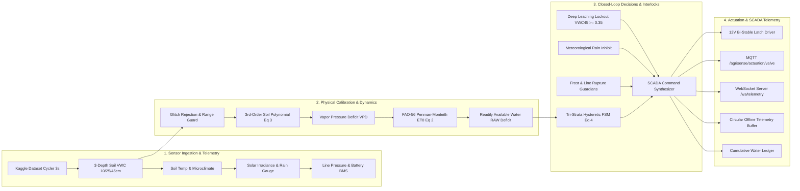

# AgriSense-Edge Pod™ Core (agrisense-edge-core)

[](https://aurosri-arman-panigrahi.github.io/agrisense-edge-portal/)
[](https://render.com/deploy?repo=https://github.com/Aurosri-Arman-Panigrahi/agrisense-edge-core)
[](LICENSE)
[](paper/AgriSense_Edge_Research_Paper.pdf)

> **Patent Pending | IPC Classification: A01G 25/16 (Agricultural Watering Control)**  
> **Authors:** Aurosri Arman Panigrahi, Aayush Saha, Ayush Pradhan, Ayush Das, Kumar Mimanshu Singh  
> **Affiliation:** Department of Computer Science & Engineering, KIIT University, Bhubaneswar, India  

---

## 🌾 Overview
This repository contains the core cyber-physical runtime, mathematical algorithms, 38-node Industry 4.0 SCADA pipeline, multi-depth soil dynamics engine, Kaggle dataset streaming cycler, and the complete IEEEtran research paper manuscript for the **AgriSense-Edge Pod™**.

- 🌐 **Live Web Portal**: [https://aurosri-arman-panigrahi.github.io/agrisense-edge-portal/](https://aurosri-arman-panigrahi.github.io/agrisense-edge-portal/)
- 📄 **Compiled IEEE Research Paper**: [Download / Read Paper PDF](paper/AgriSense_Edge_Research_Paper.pdf)

---

## 🏭 Industry 4.0 SCADA Pipeline Architecture (38 Nodes)

The visual orchestration engine executes an authentic 4-stage pipeline inside Node-RED:



---

## 🔐 Node-RED Access & Credentials

| Role | Username | Password | Privileges |
| :--- | :--- | :--- | :--- |
| **SCADA Administrator** | `admin` | `admin@12345` | Full Flow Read/Write, Deploy, Terminal, Settings |
| **Field Operator** | `operator` | `FarmOperator2026!` | Read-Only Monitor, Telemetry Inspector |

---

## 🚀 Deployment Options

### Option 1: 1-Click Cloud Deploy to Render
Deploy the Node-RED engine directly to the cloud without local hardware:
[](https://render.com/deploy?repo=https://github.com/Aurosri-Arman-Panigrahi/agrisense-edge-core)

### Option 2: Docker / Docker Compose
Run the entire stack (Node-RED + Mosquitto MQTT Broker) with one command:
```bash
cd nodered
docker compose up -d
```
Access the visual SCADA flow canvas at `http://localhost:1880/`.

### Option 3: Local Node.js Execution
```bash
cd nodered
npm install
npm start
```

---

## 📊 Directory Structure
```
agrisense-edge-core/
├── render.yaml                          # Cloud deployment blueprint (Render)
├── paper/
│   ├── main.tex                         # Complete IEEEtran research manuscript
│   ├── references.bib                   # 16 peer-reviewed BibTeX citations
│   ├── compile_paper.bat                # Automated MiKTeX pdflatex build script
│   └── AgriSense_Edge_Research_Paper.pdf # Compiled IEEE research paper (5 pages)
├── nodered/
│   ├── settings.js                      # Production Node-RED settings (bcrypt, Helmet)
│   ├── flows.json                       # 38-node Industry 4.0 SCADA pipeline
│   ├── Dockerfile                       # Containerized edge runtime
│   ├── docker-compose.yml               # Mosquitto MQTT + Node-RED stack
│   └── mosquitto/
│       └── mosquitto.conf               # Edge MQTT broker configuration
└── simulator/
    ├── kaggle_simulator.py              # Agricultural telemetry streaming daemon
    ├── requirements.txt                 # Simulator dependencies (paho-mqtt)
    └── data/
        └── kaggle_soil_telemetry.csv    # Multi-depth time-series agricultural dataset
```

---

## 📜 Citation
```bibtex
@article{panigrahi2026agrisense,
  title={AgriSense-Edge Pod: Autonomous Micro-Irrigation and Multi-Depth Soil Dynamics Engine for Edge-Class Embedded Microcontrollers},
  author={Panigrahi, Aurosri Arman and Saha, Aayush and Pradhan, Ayush and Das, Ayush and Singh, Kumar Mimanshu},
  journal={IEEE Transactions on AgriFood Electronics (Under Review)},
  year={2026}
}
```
